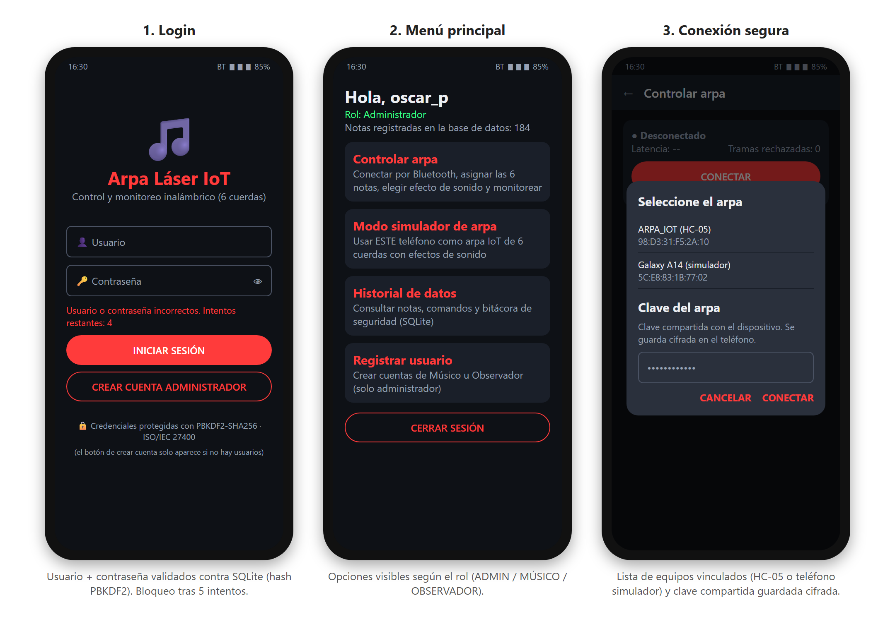
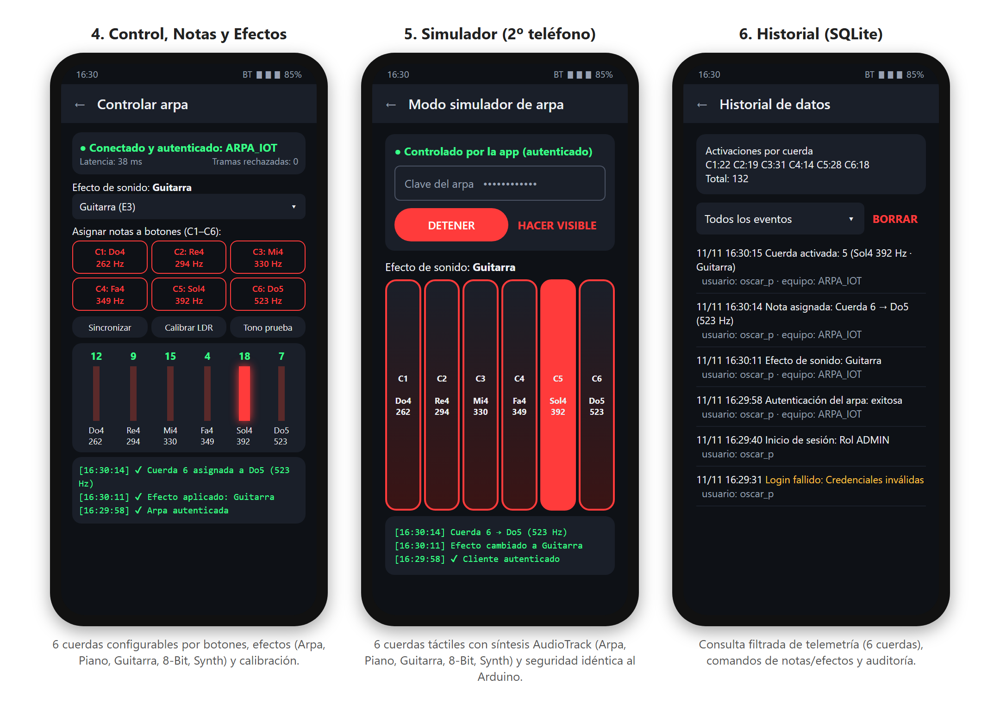
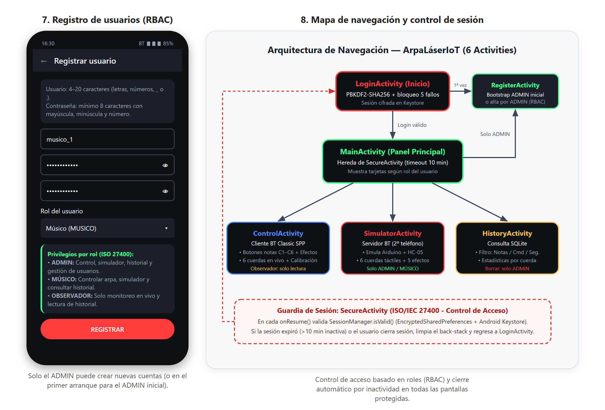
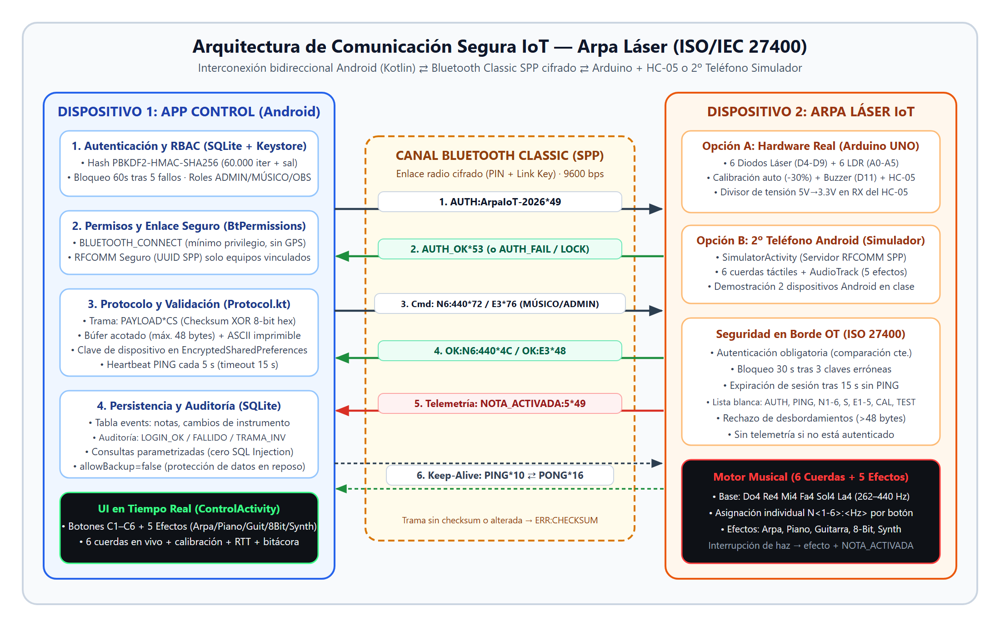

# Arpa Láser IoT — Aplicación Móvil Android (Kotlin) + Firmware Arduino (6 Cuerdas)

**Autor:** Oscar Pérez — Asignatura TI3042 (Internet de las Cosas, Unidad 2)

Aplicación móvil desarrollada en **Android Studio con Kotlin** para el control, autenticación segura, configuración musical, monitoreo en tiempo real y auditoría de un **Arpa Láser IoT de 6 cuerdas ópticas**, alineada con la norma **ISO/IEC 27400** y el desarrollo para entornos OT.

Incluye **Modo Simulador Bluetooth** integrado en el mismo APK para demostrar la interconexión bidireccional usando **dos teléfonos Android** (o un teléfono + Arduino UNO con módulo HC-05 y 6 sensores LDR + 6 diodos láser).

---

## 1. Problemática y Solución

En su funcionamiento original, el arpa láser ejecutaba de forma rígida 4 frecuencias fijas (`Do, Re, Mi, Fa`) grabadas en el microcontrolador. Cambiar las notas o el timbre obligaba a conectar el Arduino por USB y recompilar el programa, además de carecer de autenticación, control de acceso, registro histórico y validación de tramas.

**Arpa Láser IoT v2.1** amplía y resuelve la problemática integrando:
- **6 cuerdas láser configurables**: 6 sensores LDR (`A0–A5`) y 6 módulos láser (`D4–D9`), conservando la **calibración automática al inicio** (`umbralLuz[i] = luzPromedio * 0.7`) y añadiendo **recalibración remota (`CAL`)** desde la app.
- **Asignación de notas por botones (`C1–C6`)**: desde la app móvil se puede tocar cualquiera de los 6 botones de cuerda para elegir entre **22 notas musicales predefinidas** (`Do3` 131 Hz a `Mi5` 659 Hz), o aplicar 4 escalas rápidas en un toque (*Escala Mayor*, *Pentatónica*, *Acorde Menor*, *Graves/Bajo*).
- **7 efectos de sonido**: el teléfono sintetiza sus timbres en PCM (`AudioTrack`). El Arduino usa `tone()` y solo genera aproximaciones de onda cuadrada en D11; no reproduce el mismo sonido que el teléfono:
  1. `E1` — **Arpa**
  2. `E2` — **Piano**
  3. `E3` — **Guitarra**
  4. `E4` — **8-Bit Retro**
  5. `E5` — **Sintetizador**
  6. `E6` — **Guitarra eléctrica sintetizada**
  7. `E7` — **Flauta sintetizada**
- **Autenticación local robusta y RBAC**: SQLite con hash `PBKDF2-HMAC-SHA256`, bloqueo anti fuerza bruta (60 s tras 5 fallos), `EncryptedSharedPreferences` + **Android Keystore** y roles (`ADMIN`, `MUSICO`, `OBSERVADOR`).
- **Modo Simulador (2º dispositivo Android)**: convierte otro teléfono con la misma app en un servidor Bluetooth de 6 cuerdas táctiles con los 7 efectos de audio.

---

## 2. Arquitectura y Estructura del Proyecto

```text
ArpaLaserIoT/
├── app/src/main/
│   ├── AndroidManifest.xml                  # Permisos Bluetooth (mínimo privilegio) y políticas de backup/red
│   ├── java/com/arpalaser/iot/
│   │   ├── bluetooth/
│   │   │   ├── BluetoothLink.kt             # Cliente/Servidor RFCOMM SPP seguro + lectura acotada (48 bytes)
│   │   │   ├── BtPermissions.kt             # Permisos dinámicos Android 8–11 vs Android 12+
│   │   │   └── Protocol.kt                  # Tramas PAYLOAD*CS, 6 cuerdas, catálogo de notas, presets y 7 efectos
│   │   ├── data/
│   │   │   ├── DatabaseHelper.kt            # Esquema SQLite (tablas users y events)
│   │   │   ├── UserRepository.kt            # Registro/login con bloqueo tras 5 fallos (SQL parametrizado)
│   │   │   └── EventRepository.kt           # Bitácora de notas, config de notas, efectos, calibración y seguridad
│   │   ├── security/
│   │   │   ├── InputValidator.kt            # Validación de usuarios, contraseñas y claves de dispositivo
│   │   │   ├── PasswordHasher.kt            # PBKDF2WithHmacSHA256 (60.000 iteraciones + sal aleatoria 16B)
│   │   │   ├── Role.kt                      # RBAC: ADMIN, MUSICO, OBSERVADOR
│   │   │   └── SessionManager.kt            # EncryptedSharedPreferences + Android Keystore + notas/efecto guardados
│   │   ├── ui/
│   │   │   ├── SecureActivity.kt            # Guardia base de sesión (timeout 10 min)
│   │   │   ├── LoginActivity.kt             # Login y bootstrap de cuenta ADMIN inicial
│   │   │   ├── RegisterActivity.kt          # Alta de usuarios (solo bootstrap o ADMIN)
│   │   │   ├── MainActivity.kt              # Panel principal filtrado por rol
│   │   │   ├── ControlActivity.kt           # Cliente BT: botones C1–C6, selector efecto, calibración, 6 cuerdas en vivo
│   │   │   ├── SimulatorActivity.kt         # Servidor BT: 2º teléfono simulando las 6 cuerdas + 7 efectos
│   │   │   └── HistoryActivity.kt           # Consulta SQLite filtrada y estadísticas C1–C6
│   │   └── util/
│   │       └── TonePlayer.kt                # Síntesis PCM multi-timbre (Arpa, Piano, Guitarra, 8-Bit, Sintetizador)
│   └── test/java/com/arpalaser/iot/
│       ├── ProtocolTest.kt                  # 5 pruebas unitarias (6 cuerdas, rangos, efectos, checksum, whitelist)
│       └── SecurityTest.kt                  # 5 pruebas unitarias (PBKDF2, políticas y RBAC)
├── arduino/arpa_laser_iot/
│   └── arpa_laser_iot.ino                   # Firmware Arduino UNO: 6 LDR + 6 láser + calibración + 7 efectos + ISO 27400
└── docs/                                    # Mockups de interfaz (6 cuerdas) y diagrama de arquitectura segura
```

---

## 3. Diseño de Interfaz (Mockups) y Arquitectura Segura






---

## 4. Protocolo Seguro App ⇄ Arpa (6 Cuerdas + Efectos)

Tramas ASCII terminadas en `\n` con verificación XOR de 8 bits (límite máximo `48` bytes):

```text
PAYLOAD*CS\n      (CS = XOR hexadecimal de 2 dígitos)
```

| Dirección | Trama ejemplo | Descripción |
|---|---|---|
| App → Arpa | `AUTH:ArpaIoT-2026*49` | Autentica la app contra el dispositivo antes de operar |
| Arpa → App | `AUTH_OK*53` / `AUTH_FAIL` / `AUTH_LOCK` | Resultado de autenticación o bloqueo (30 s tras 3 fallos) |
| App → Arpa | `N6:440*72` | Asigna frecuencia (`65..2000 Hz`) a una cuerda (`1..6`) |
| App → Arpa | `S:262,294,330,349,392,440*4A` | Sincroniza las 6 notas de una vez (preset o al conectar) |
| App → Arpa | `E3*76` | Cambia el efecto de sonido (`E1` Arpa .. `E5` Sintetizador) |
| App → Arpa | `CAL*4E` / `TEST*16` | Recalibra los 6 sensores LDR / emite tono de prueba (440 Hz) |
| Arpa → App | `NOTA_ACTIVADA:5*49` | Telemetría de cuerda activada (`1..6`), solo si está autenticado |
| App ⇄ Arpa | `PING*10` / `PONG*16` | Keep-alive cada 5 s (sesión expira a los 15 s sin tramas) y RTT |

---

## 5. Conexión Hardware Real (Arduino UNO + 6 Sensores + HC-05)

| Componente | Pines Arduino UNO | Notas técnicas |
|---|---|---|
| **6 Fotoreceptores (LDR)** | `A0, A1, A2, A3, A4, A5` | Calibración automática individual al iniciar (`promedio * 0.7`) y remota vía comando `CAL`. |
| **6 Diodos Láser** | `D4, D5, D6, D7, D8, D9` | Encendidos automáticamente en `setup()`. |
| **Buzzer / Minibuffer** | `D11` | Reproduce tonos y los 5 efectos sin bloquear la lectura de sensores. |
| **Módulo Bluetooth HC-05** | `D2` (RX Arduino ← TX HC-05)<br>`D3` (TX Arduino → RX HC-05) | Usar divisor resistivo `1 kΩ + 2 kΩ` (5 V → 3.3 V) en el pin `RXD` del HC-05. |

**Hardening del HC-05 (comandos AT antes de desplegar):**
```text
AT+NAME=ARPA_IOT
AT+PSWD="4829"
AT+UART=9600,0,0
```

---

## 6. Medidas de Seguridad (ISO/IEC 27400) y Pruebas Unitarias

- **Credenciales y secretos**: `PBKDF2WithHmacSHA256` (60.000 iter + sal 16B) y `EncryptedSharedPreferences` con llave maestra en **Android Keystore**.
- **Control de acceso y permisos**: RBAC (`ADMIN`, `MUSICO`, `OBSERVADOR`), expiración de sesión (10 min en app, 15 s en dispositivo), `BLUETOOTH_CONNECT`/`BLUETOOTH_ADVERTISE` sin ubicación GPS.
- **Integridad de canal**: Sockets RFCOMM cifrados, checksum XOR `*CS`, lista blanca estricta (`AUTH`, `PING`, `N1-6`, `S`, `E1-5`, `CAL`, `TEST`), búfer acotado (`48` bytes).
- **Pruebas unitarias (`10/10` aprobadas)**: `./gradlew testDebugUnitTest assembleDebug` (`ProtocolTest` + `SecurityTest`).
